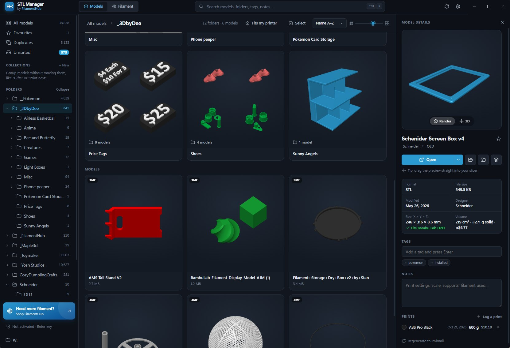
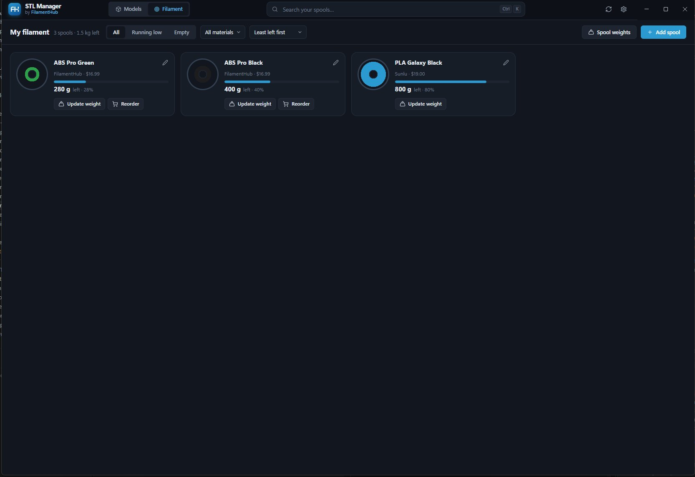

# STL Manager by FilamentHub

**A free Windows app for your 3D printing.** Find any model in seconds and keep track of how much filament you've got left.

## Download

Get the latest version from [Releases](../../releases/latest):

- **FilamentHub-STL-Manager-Setup-x.x.x.exe**: installs like any Windows app (recommended)
- **FilamentHub-STL-Manager-x.x.x-Portable.exe**: runs without installing, handy on a USB stick

Windows 10 and 11, 64-bit. Free for everyone, no account needed.

## Your model library

- **See every model.** Thumbnails for all your STL and 3MF files, with the picture your slicer saved in 3MFs from Bambu Studio, OrcaSlicer and PrusaSlicer.
- **Spin it in 3D** before you print.
- **Tags, favourites, notes and search** across your whole library.
- **Collections** like "Gifts" or "Print next", without moving any files.
- **Unsorted inbox** for new downloads, including the models inside .zip files. Tag them, then file them away in one click.
- **Find duplicates**, even with different names in different folders.
- **Will it fit?** Pick your printer and see which models fit the build plate.
- **Open in your slicer**, or drag a model straight into it.
- **Fast with big libraries**, tens of thousands of models, including on a NAS. Changes made in Explorer or your browser show up within seconds.

## Your filament

- **Track your spools**, FilamentHub or any other brand. Weigh a spool to see how much is left.
- **Log prints** to take the filament off the spool and see what each print cost.
- **Running-low alerts** when a spool drops below 25%, and one-click reorder of FilamentHub spools.

## Your data stays on your PC

Your files are never uploaded. Tags, notes and spools are saved on your PC, and **Export backup** moves them to a new one.

## Feedback

Found a bug or have an idea? Use **Send feedback** in the app, or [open an issue](../../issues).

---

Made by [FilamentHub](https://www.filamenthub.com.au), 3D printing filament from Australia.
